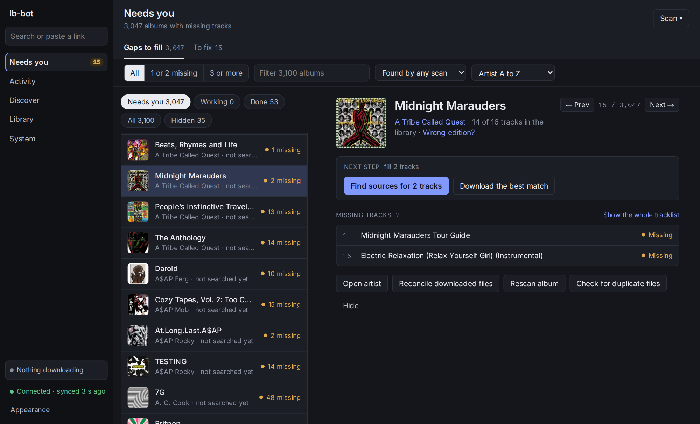

# lb-bot

A self-hosted **music-library gap-filler**. It scans a Navidrome library for
missing tracks and incomplete albums, acquires the missing audio from Soulseek
(via slskd), and places it back into the library — correctly tagged, no retagging
of what's already there. It runs as a single long-lived Python process exposing
**both a Telegram bot and a React web UI**.

It also has a **second front end you don't run yourself**: through
[navi-connect](https://github.com/illuminator69/navi-connect), lb-bot's
discography and gap-filling surface appears *inside* the music players — the
albums you're missing show up on the artist page next to the ones you own, and a
download is reviewed and started from there. If that's what you came for, the
[navi-connect setup guide](https://github.com/illuminator69/navi-connect/blob/main/TESTING-SETUP.md)
is the place to start; it covers both halves.

<p align="center">
  
</p>

---

## What it does (scope)

The core loop, in the confirmed spec order:

1. **Scan** the library for missing tracks (from ListenBrainz playlists, Spotify
   playlists, or MusicBrainz discography checks).
2. **Produce a review** — a JSON of missing tracks/albums the user can inspect.
3. **Acquire** — the user (or an auto mode) chooses what to download and from
   which Soulseek source. Source selection is failover-aware because peers
   frequently reject or stall.
4. **Place** — downloaded tracks are moved into the existing album folder,
   tagged from canonical MusicBrainz metadata, and verified present in Navidrome.
   No existing library files are retagged.

All four run unattended. Steps 3–4 are where the care went: a peer's folder has
to show *the album* — not only the artist — before anything is taken from it, a
click on a source downloads that source and no other, and placement files
nothing that has not shown the album. [`docs/ARCHITECTURE.md`](docs/ARCHITECTURE.md)
has the rules; [`docs/STATUS.md`](docs/STATUS.md) says what has and has not been
confirmed on a live stack.

Around that loop it lets you say what the library holds, each of them undoable:

- **which MusicBrainz artist** a library artist is, when the tags or lb-bot's own
  guess got it wrong;
- **which release an album is** — lb-bot retags the album's files to the edition
  you pick, and can save a Cover Art Archive cover with it;
- **that two artist names are one artist** — "A & B" and "A and B" are two
  artists to Navidrome; a merge rewrites one spelling to the other.

It also mirrors your ListenBrainz listens, to show what you play most that the
library does not hold.

The web UI has five sections — **Needs you** (the queue of albums with gaps, and
the things only you can decide), **Activity**, **Discover**, **Library** and
**System** — with artist and album pages opening on top of whichever you were in.

**Format policy:** only `flac` and `opus` are accepted (`FORMAT_PRIORITY`).
Everything else is rejected at search time. Placement and retagging also handle
`mp3` (ID3), since a group can opt into mp3 as a last resort.

---

## Quick start

A prebuilt image is published to GHCR on every push to `main`, and
`docker-compose.yml` pulls from there:

```bash
cp .env.example .env     # then edit — Telegram token, Navidrome, slskd, MusicBrainz contact
docker compose pull && docker compose up -d
```

The web UI is on **:8899**. Three mounts have to be writable by the container's uid,
including the downloads directory — placement unlinks the source file after copying.
[`docs/DEPLOYMENT.md`](docs/DEPLOYMENT.md) has the mounts, every environment variable,
the Telegram commands, the one-time `chown` that fixes "attempt to write a readonly
database", and the one Navidrome setting ("Report Real Path" for lb-bot's player)
without which retagging an album, changing its cover or merging two artist names is
refused.

To run it directly instead:

```bash
pip install -r requirements.txt
cd web && npm ci && npm run build     # or `npm run dev` for HMR
python listenbrainz_bot.py            # bot + web UI on :8899
```

---

## Documentation

| | |
|---|---|
| [`docs/ARCHITECTURE.md`](docs/ARCHITECTURE.md) | What the process is doing: the three concurrent halves, the state files and index schema, the systems it talks to, the `/api/*` surface, the overrides and the listens mirror, and how acquisition and placement actually work. |
| [`docs/DEPLOYMENT.md`](docs/DEPLOYMENT.md) | Docker, mounts and ownership, what Navidrome must be set to, every environment variable, local development, Telegram commands. |
| [`CLAUDE.md`](CLAUDE.md) | The long-form design notes: every rule with its reason, written as the work was done, oldest sections kept as history. Where it and the architecture page disagree about the present, the architecture page is the current one. **Read the relevant section before touching acquisition or placement.** |
| [`docs/STATUS.md`](docs/STATUS.md) | How far to trust each part: what has been confirmed on a live stack, what is built and not confirmed, and the known limits. |

Line numbers in `CLAUDE.md` and in code comments are snapshot hints and drift —
navigate by function name.

---

## Repo map

- `listenbrainz_bot.py` — everything (bot, web server, API, workers, placement).
- `web/` — React SPA (Vite/Tailwind); `web/dist` is the built output served by Flask.
  What a page may say lives in pure modules under `web/src/lib/`, each with a test
  beside it: `node --test web/src/lib/*.test.mjs`, no dependency.
- `Dockerfile`, `docker-compose.yml` — build & runtime.
- `requirements.txt` — Python deps (`mutagen` declared explicitly
  post-beets-removal; `rapidfuzz` for folder ranking and file↔track matching —
  wheels only, and the code falls back to `difflib` if it is missing rather than
  failing to import).
- `docs/` — architecture, deployment and status.
- `CLAUDE.md` — authoritative design notes; **read before editing the pipeline.**
- `AGENTS.md` — agent instructions.
- `test_album_review.py` — test scaffolding for the album-review flow. Its
  baseline is **0 errors, 0 failures** (the 32 stale beets tests were deleted);
  the test count drifts as tests are added, so check the 0/0 invariant, not a
  total. Anything beyond that is yours.
