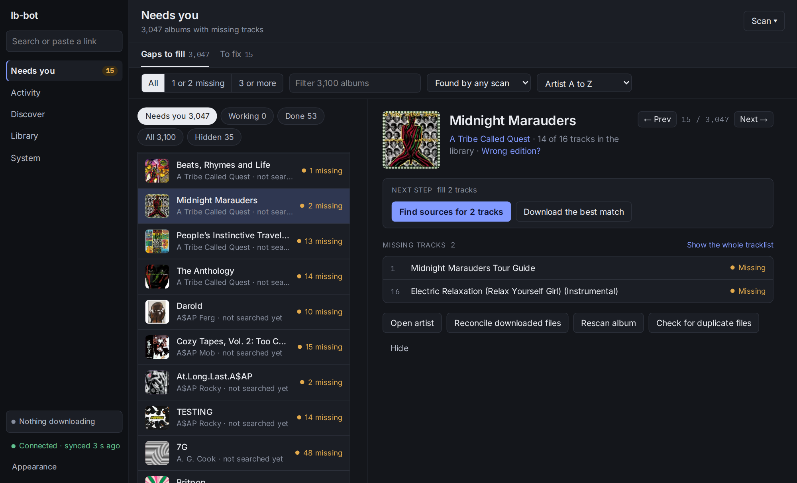

# lb-bot

The discography index inside [Worbus Server](https://github.com/illuminator69/worbus): it
**shows every album your library is missing, and where to find it.** It reads a Navidrome
library, matches each artist to MusicBrainz, and keeps the full discography beside what you
own, so the gaps are a list rather than a hunch. It needs a Navidrome server and a
MusicBrainz contact address, and, for the Worbus apps to reach it, the Worbus Server hub's
address and token (the three REQUIRED groups in `.env.example`). It runs as a single long-lived Python
process exposing **a React web UI behind a Navidrome login**. (Its Telegram bot was removed in
Worbus 0.4: a failed import is listed on the web page, under Needs you, and the apps link there.)

It also has a **second front end you don't run yourself**: through
[Worbus](https://github.com/illuminator69/worbus), lb-bot's
discography and gap surface appears *inside* the music players — the
albums you're missing show up on the artist page next to the ones you own, each with where to
find it. The two apps,
[Worbus for Android](https://github.com/illuminator69/worbus-android) and
[Worbus for desktop](https://github.com/illuminator69/worbus-desktop), also carry lb-bot's
Needs attention (admin account), activity (called Source history in Worbus for Android) and listening pages. If that's what you came for, the
[Worbus install guide](https://github.com/illuminator69/worbus/blob/main/INSTALL.md)
is the place to start; it covers both halves. Worbus is not affiliated with Navidrome.

<p align="center">
  
</p>

---

## What it does (scope)

The core loop, in the confirmed spec order:

1. **Index** each artist's discography from MusicBrainz and compare it with what
   Navidrome holds (and, if you like, with your ListenBrainz or Spotify playlists).
2. **Review** — a list of the missing albums and tracks you can inspect, each with
   links to where it can be found.
3. **Place** (optional, only when you turn on downloading; see
   [Downloading (optional)](#downloading-optional)) — an album that arrives in the
   library's import folder is moved into the existing album folder, tagged from
   canonical MusicBrainz metadata, and verified present in Navidrome. No existing
   library files are retagged.

Indexing and review run unattended. Placement files nothing that has not shown
the album. [`docs/ARCHITECTURE.md`](docs/ARCHITECTURE.md)
has the rules; [`docs/STATUS.md`](docs/STATUS.md) says what has and has not been
confirmed on a live stack.

Around that loop it lets you say what the library holds, each of them undoable:

- **which MusicBrainz artist** a library artist is, when the tags or lb-bot's own
  guess got it wrong;
- **which release an album is** — lb-bot retags the album's files to the edition
  you pick, and can save a Cover Art Archive cover with it;
- **that two artist names are one artist** — "A & B" and "A and B" are two
  artists to Navidrome; a merge rewrites one spelling to the other.

It also mirrors your ListenBrainz listens, to show what you play most that the
library does not hold.

The web UI has five sections — **Needs you** (the queue of albums with gaps, and
the things only you can decide), **Activity**, **Discover**, **Library** and
**System** — with artist and album pages opening on top of whichever you were in.

---

## Quick start

A prebuilt image is published to GHCR on every push to `main`, and
`docker-compose.yml` pulls from there:

```bash
cp .env.example .env     # then edit — Navidrome, the hub's address and token, MusicBrainz contact
                         # (ListenBrainz and downloading are optional)
docker compose pull && docker compose up -d
```

The web UI is on **:8899**. The mounts have to be writable by the container's uid.
[`docs/DEPLOYMENT.md`](docs/DEPLOYMENT.md) has the mounts, every environment variable,
the one-time `chown` that fixes "attempt to write a readonly database", and the one Navidrome setting ("Report Real Path" for lb-bot's player)
without which retagging an album, changing its cover or merging two artist names is
refused.

To run it directly instead:

```bash
pip install -r requirements.txt       # Python 3.12, the image's
cd web && npm ci && npm run build     # or `npm run dev` for HMR
python listenbrainz_bot.py            # bot + web UI on :8899
```

---

## Downloading (optional)

lb-bot can also fetch a missing album for you and place it in the library. It is off
until you set it up, and everything above works without it. The setup, and how the
fetching is kept careful, are in [`docs/DOWNLOADING.md`](docs/DOWNLOADING.md).

---

## Documentation

| | |
|---|---|
| [`docs/ARCHITECTURE.md`](docs/ARCHITECTURE.md) | What the process is doing: the three concurrent halves, the state files and index schema, the systems it talks to, the `/api/*` surface, the overrides and the listens mirror, and how placement and the optional downloading actually work. |
| [`docs/DOWNLOADING.md`](docs/DOWNLOADING.md) | The optional downloading mode: what it needs, how to turn it on, and the rules a download is held to. |
| [`docs/DEPLOYMENT.md`](docs/DEPLOYMENT.md) | Docker, mounts and ownership, what Navidrome must be set to, every environment variable, local development, what replaced the Telegram commands. |
| [`CLAUDE.md`](CLAUDE.md) | The long-form design notes: every rule with its reason, written as the work was done, oldest sections kept as history. Where it and the architecture page disagree about the present, the architecture page is the current one. **Read the relevant section before touching placement or the downloading path.** |
| [`docs/STATUS.md`](docs/STATUS.md) | How far to trust each part: what has been confirmed on a live stack, what is built and not confirmed, and the known limits. |

Line numbers in `CLAUDE.md` and in code comments are snapshot hints and drift —
navigate by function name.

---

## Repo map

- `listenbrainz_bot.py` — everything (bot, web server, API, workers, placement).
- `web/` — React SPA (Vite/Tailwind); `web/dist` is the built output served by Flask.
  What a page may say lives in pure modules under `web/src/lib/`, each with a test
  beside it: `node --test web/src/lib/*.test.mjs`, no dependency.
- `Dockerfile`, `docker-compose.yml` — build & runtime.
- `requirements.txt` — Python deps (`mutagen` declared explicitly
  post-beets-removal; `rapidfuzz` for folder ranking and file↔track matching —
  wheels only, and the code falls back to `difflib` if it is missing rather than
  failing to import).
- `docs/` — architecture, deployment, downloading and status.
- `CLAUDE.md` — authoritative design notes; **read before editing the pipeline.**
- `AGENTS.md` — agent instructions.
- `test_album_review.py` — test scaffolding for the album-review flow. Its
  baseline is **0 errors, 0 failures** (the 32 stale beets tests were deleted);
  the test count drifts as tests are added, so check the 0/0 invariant, not a
  total. Anything beyond that is yours.

## Licence

lb-bot is free software under the GNU General Public License, version 3 or later (`GPL-3.0-or-later`); the text is
in [LICENSE](LICENSE). Copyright (C) 2026 Worbus contributors.

It uses [mutagen](https://github.com/quodlibet/mutagen) (GPL-2.0-or-later) and other libraries, each under its own
licence (`requirements.txt` lists them).
